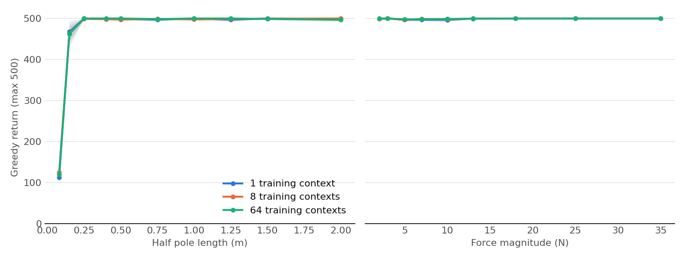

# Does PPO generalize across held-out physics? A small study in JAX

Not peer reviewed, not a publication. Small environment, small scale.

> **STATUS: Part A measured (Actions runs 42539326774 and 42539889801). Part B not run.**
> **Part A short answer:** every condition reached near the 500-step ceiling, on training and interpolation contexts alike, so this task could not separate the conditions. Training on more contexts showed no detectable benefit here. That is a limit of the setup, not evidence that variation never helps.
> **Part B: NOT RUN. Part B has no results until `colab/dpo_colab.ipynb` is run on Colab.**

## 1. Question
If an agent performs well on the task variations it trained on, does it also perform well on variations it never saw? And does training on more distinct variations help?

## 2. Part A setup
**Environment.** CartPole-v1 dynamics in JAX (`src/rlgen/env.py`). A context is a half pole length, pole mass, cart mass and force magnitude, hidden from the agent.

**Conditions.** 1 context (the unmodified task), or 8 or 64 contexts drawn from the training box. Ten seeds per condition, each drawing its own training contexts.

| Parameter | Training box | Outside bands (extrapolation) |
|---|---|---|
| Half pole length (m) | 0.25 to 0.75 | 0.08 to 0.25, 0.75 to 1.5 |
| Pole mass (kg) | 0.05 to 0.20 | 0.02 to 0.05, 0.20 to 0.5 |
| Cart mass (kg) | 0.7 to 1.3 | 0.3 to 0.7, 1.3 to 2.5 |
| Force (N) | 7 to 13 | 3 to 7, 13 to 25 |

**Held-out sets**, the same for every seed and condition, 64 contexts each: *interpolation* (new draws from the box) and *extrapolation* (exactly one parameter outside the box). The 1-context condition has never seen most of the box, so "interpolation" is a stretch for it.

**Evaluation.** Greedy policy, 8 episodes per context. Means and 95% percentile-bootstrap intervals over seeds. The train minus held-out gap is computed per seed, then bootstrapped. Baselines: uniform random policy and a hand-written rule (push toward `theta + theta_dot`). The design is fixed in `experiments/config.py` and `src/rlgen/contexts.py` before the first full run; later changes must be recorded here.

## 3. Math
**PPO objective.** With $r_t(\theta) = \pi_\theta(a_t|s_t) / \pi_{\theta_{old}}(a_t|s_t)$ and advantage estimate $\hat A_t$:

$$L^{CLIP}(\theta) = \mathbb{E}_t\big[\min\big(r_t(\theta)\hat A_t,\ \mathrm{clip}(r_t(\theta), 1-\epsilon, 1+\epsilon)\hat A_t\big)\big]$$

The loss minimized is $-L^{CLIP} + c_v L^{V} - c_e H[\pi_\theta]$, with $L^V$ the clipped squared value error and $H$ the policy entropy.

**GAE.** With $\delta_t = r_t + \gamma(1-d_t)V(s_{t+1}) - V(s_t)$:

$$\hat A_t = \sum_{l\ge 0}(\gamma\lambda)^l \delta_{t+l}, \quad\text{computed as}\quad \hat A_t = \delta_t + \gamma\lambda(1-d_t)\hat A_{t+1}.$$

$\lambda=0$ gives the one-step TD error and $\lambda=1$ the discounted return minus the value; both are unit tests. Value targets are $\hat A_t + V(s_t)$.

**Time limits.** The 500-step limit is not a terminal state, so on truncation the reward is augmented with $\gamma V(s_{final})$.

**Diagnostics per update.** Explained variance $1 - \mathrm{Var}[R-V]/\mathrm{Var}[R]$, approximate KL $\mathbb{E}[(r-1) - \log r]$, clip fraction, gradient global norm before clipping.

## 4. Part A results
Conditions: GitHub Actions `ubuntu-latest` CPU runner, JAX 0.4.35, 10 seeds, 500,000 environment steps per seed, greedy evaluation, 64 held-out contexts, 8 episodes per context. Source: `results/part_a/study.json`. All three conditions trained in about 30 s each (10 seeds at once with `vmap`).

Mean return with 95% bootstrap CI over seeds (maximum 500):

| Training contexts | Own training contexts | Held-out interpolation | Held-out extrapolation |
|---|---|---|---|
| 1 (unmodified task) | 500.0 [500.0, 500.0] | 498.2 [497.0, 499.2] | 483.0 [480.5, 485.1] |
| 8 | 498.8 [497.8, 499.5] | 498.2 [496.6, 499.3] | 482.8 [480.2, 485.3] |
| 64 | 498.8 [497.9, 499.5] | 498.8 [497.8, 499.6] | 482.4 [479.9, 484.8] |
| *Baseline: random policy* | n/a | 21.9 | 23.8 |
| *Baseline: hand-written rule* | n/a | 476.4 | 441.5 |

Paired per-seed gap, train minus held-out:

| Training contexts | Train minus interpolation | Train minus extrapolation |
|---|---|---|
| 1 | 1.8 [0.8, 3.0] | 17.0 [14.9, 19.5] |
| 8 | 0.6 [-0.1, 1.4] | 16.0 [13.6, 18.3] |
| 64 | -0.1 [-0.5, 0.3] | 16.4 [14.5, 18.2] |

Reading:

- **PPO generalized well in this task.** The interpolation gap is under 2 points of 500 in every condition, and extrapolation loses about 16 to 17 points.
- **More training contexts gave no detectable benefit.** Extrapolation intervals overlap almost entirely. The small interpolation gap for 1 context (1.8) comes with a training score pinned at the ceiling, so it is not evidence of a real advantage for 8 or 64.
- **There is a ceiling effect.** The hand-written rule alone scores 476 on interpolation contexts, so the task is easy and the metric saturates. This study cannot detect differences among policies that all balance the pole.
- **The extrapolation loss is concentrated in short poles.** In the one-parameter sweeps with other physics at nominal values, returns stay near 500 for half lengths of 0.25 m and above and for all forces from 2 to 35 N, but fall to about 465 at 0.15 m and about 120 at 0.08 m in all conditions. Very short poles have fast dynamics, and the policy sees only the state. These are observations; the study did not test the cause.

## 5. Debugging the training process
### 5.1 What the first real run showed

The returns looked fine, but the diagnostics in `results/part_a/diagnostics.json` did not:

- **Weak critic.** Explained variance was only about 0.2 to 0.5 for the whole run, and 0.27 over the final quarter in the 8-context condition.
- **Gradient clipping always active.** The global gradient norm averaged about 22 against a clip threshold of 0.5.
- **Very small policy steps.** Approximate KL was about 0.0005 in the first quarter of training, with a maximum per-update mean of 0.0026.

**The "zero" approximate KL was not a bug.** The CLI demo printed `approx KL 0.0000`. The learning rate anneals linearly, so the last update runs at `lr / num_updates`. In a local check (40,000 steps, 19 updates, 1 seed) the last-update KL was 2.0e-6 with annealing and 7.3e-4 without. The study's final-quarter mean is 2e-6. The value printed was rounding of a real, tiny quantity.

### 5.2 Testing two explanations (exploratory, added after seeing the results)

I proposed two causes: (a) value clipping at ±0.2 makes no sense for unnormalized returns near 100, and (b) unscaled returns give the critic large gradients, and the joint norm clip then shrinks the whole update, including the actor's. `experiments/debug_value.py`, 8 training contexts, 10 seeds, same steps. Source: `results/part_a/debug_value.json`.

| Variant | Held-out interpolation | Mean training return, whole run | EV, final quarter | Approx KL, first quarter | Mean grad norm |
|---|---|---|---|---|---|
| As in the study | 498.2 [496.6, 499.3] | 373.5 [358.6, 386.5] | 0.27 | 0.00052 | 22.1 |
| No value clipping | 462.5 [423.8, 499.3] | 347.2 [318.1, 375.3] | 0.08 | 0.00070 | 19.7 |
| Rewards × 0.01 | 500.0 [500.0, 500.0] | 449.7 [441.9, 456.5] | -0.98 | 0.00169 | 0.20 |
| No value clipping, rewards × 0.01 | 500.0 [500.0, 500.0] | 450.2 [444.3, 455.8] | -1.04 | 0.00164 | 0.20 |

- **Explanation (a) was wrong.** Removing value clipping did not help; the point estimates got worse and the critic's explained variance fell.
- **Scaling rewards fixed the learning speed.** The gradient norm fell from about 22 to 0.2, below the clip threshold, approximate KL roughly tripled, and mean training return rose from 373.5 to 449.7 with non-overlapping intervals. This fits explanation (b), though actor and critic gradients were not measured separately.
- **Explained variance did not track performance.** The best-performing variants have strongly negative final explained variance, while the return is at the ceiling. I did not establish why, so I do not treat explained variance as a reliable health signal in this setup, especially near saturation.
- **The main study was left as pre-specified**, with no reward scaling, so its numbers in section 4 were not tuned after seeing them. Scaling would probably not change the conclusion, because held-out interpolation was already within 2 points of the ceiling.

### 5.3 Fault injection (deliberate, not bugs I hit)

Each row re-introduces one mistake on purpose. 8 training contexts, 10 seeds. Source: `results/part_a/faults.json`.

| Injected change | Held-out interpolation | EV, final quarter | Max approx KL |
|---|---|---|---|
| None (correct) | 498.2 [496.6, 499.3] | 0.27 | 0.0026 |
| GAE ignores episode ends | 20.6 [10.3, 38.9] | 0.00 | 0.0018 |
| Truncation treated as termination | 498.5 [497.8, 499.2] | 0.23 | 0.0026 |
| No advantage normalization | 495.0 [490.2, 498.5] | 0.29 | 0.0043 |
| Learning rate 1e-2, no annealing | 500.0 [500.0, 500.0] | -0.81 | 0.1088 |

Only the GAE mistake was clearly harmful: it stayed near the random baseline for the whole run, and explained variance stayed at 0. The truncation and normalization mistakes had no detectable effect on final return in this task. The tenfold learning rate gave the top score despite a poor critic and a KL about 40 times higher. Because of the ceiling, a final return this close to 500 does not show these changes are safe in general.

## 6. Part B: DPO on a small language model
**NOT RUN. There are no Part B results.** `colab/dpo_colab.ipynb` trains `HuggingFaceTB/SmolLM2-135M-Instruct` with a hand-written DPO loss on 2000 pairs from `Anthropic/hh-rlhf` (`helpful-base`), and measures preference accuracy on 500 training pairs and 500 held-out pairs across 3 seeds, against the untrained reference model and a "longer response wins" baseline. Output belongs at `results/part_b/dpo_results.json`.

## 7. Limitations
- **Ceiling effect:** returns saturate at 500 and a simple rule scores 476, so the study cannot distinguish strong policies. A harder task would be needed to answer the question about the number of training contexts.
- Section 5.2 is exploratory and was designed after seeing the results.
- CartPole is small and low-dimensional; conclusions may not carry over.
- Physics variation only, along four parameters.
- Ten seeds give wide intervals, and a percentile bootstrap at this sample size is somewhat too narrow.
- One hyperparameter setting, not tuned per condition.
